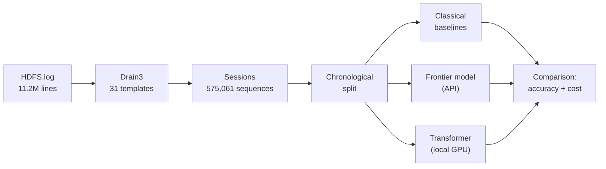

# Log Anomaly Detection — small models vs frontier models

> Servers produce millions of log lines a day, and buried in them are the handful
> that mean something is broken. A big AI model like ChatGPT can spot those
> reliably, but it's far too slow and expensive to run across millions of lines,
> so nobody actually does it that way. I'm training my own small model to do that
> one narrow job, then measuring it head to head against the big model — how much
> accuracy do I give up, and how much cheaper and faster is it? I'm doing it
> because my job right now is plugging existing AI models into things, and I want
> to understand how they're actually built: the training, the data, the tradeoffs.

**Status: in progress — week 5 of 16.** Data pipeline, evaluation harness,
classical baselines and the frontier-model baseline are complete. The project's
own trained model is pending. Everything reported below is reproducible from
this repo.

---

## Pipeline



Raw log lines are parsed into event *templates*, grouped into one sequence per
HDFS block, split by time, and fed to every approach identically.

---

## Results so far

| Approach | Precision | Recall | F1 | Cost / 1M lines |
|---|---|---|---|---|
| **TF-IDF + logistic regression** | 0.9935 | 0.9973 | **0.9954** | ~$0 |
| **Rules v2** (hand-written conditionals) | 0.9164 | 0.9716 | **0.9432** | **~$0** |
| **Claude Haiku 5.5**, expert prompt | 0.9091 | 0.9756 | **0.9412** | **$8.15** |
| **Claude Sonnet 5.5**, expert prompt | 0.9091 | 0.9756 | **0.9412** | **$124.29** |
| Lookup table (pure memorisation) | 1.0000 | 0.8507 | 0.9193 | ~$0 |
| Rules v1 (marker templates only) | 0.9055 | 0.8454 | 0.8744 | ~$0 |
| **Claude Sonnet 5.5**, bare prompt | 0.9630 | 0.7927 | **0.8696** | **$75.72** |
| Naive keyword (`error`/`exception`) | 1.0000 | 0.6688 | 0.8016 | ~$0 |
| Length only (`len < 13`) | 1.0000 | 0.2763 | 0.4330 | ~$0 |
| This project's trained model | — | — | *pending* | *pending* |

*Validation split, natural class ratio. Frontier rows measured on a random 5,000-session
subset (164 anomalies); other rows on all 86,254. Accuracy is deliberately not reported —
at a 2.93% positive rate, always predicting "normal" scores 97%.*

---

## Two findings

### 1. The frontier model's performance is the prompt, not the model

| What the model was given | F1 | Cost / 1M lines |
|---|---|---|
| A bare instruction ("is this block broken?") | 0.8696 | $75.72 |
| The same instruction plus domain knowledge from EDA | 0.9412 | $124.29 |
| **That knowledge expressed as code instead** | **0.9432** | **~$0** |

Domain knowledge is worth +0.072 F1. The model adds nothing beyond it — given the
same knowledge, forty lines of conditional logic match it, at no cost and in
microseconds instead of 1.2 seconds. The expert prompt also costs **64% more** than
the bare one, because the rules make the prompt longer.

Without domain knowledge the model fails by *missing* anomalies, not by crying wolf:
precision rises to 0.9630 while recall falls to 0.7927. For an on-call detector that
is the expensive direction to be wrong in.

### 2. Model capability is irrelevant when the prompt is a decision procedure

Sonnet 5.5 and Haiku 5.5, given the same expert prompt, produced **identical
predictions on all 5,000 sessions** — the same verdict on every block, including all
16 false alarms and all 4 misses. The two models differ by ~15× in measured cost.

> If a prompt is specific enough to be reliable, it is probably specific enough to be code.

### Latency makes the point without reference to money

At 1.21 s per session, classifying all 575,061 blocks is **193 hours of serial API
time** — eight days to analyse 38 hours of logs from one cluster. Even at the
concurrency sustained here, 25 hours. Not expensive: impossible.

---

## The benchmark is near-saturated

**HDFS, the most-cited benchmark in log anomaly detection, is close to solved by
memorisation.**

**Why a dictionary scores 0.92:**

```
distinct sequences in training:                 17,458   (from 402,549 blocks)
validation sequences seen verbatim in training: 99.2%
```

Across 575,061 blocks there are only ~17k distinct behaviours. Memorising
training sequences and looking up new ones achieves F1 0.9193 with **perfect
precision** — no model, no features, no training.

Every error that lookup makes is a sequence it has never seen:

```
unseen sequences in validation:   674
  of which anomalous:             389   (57.7%, vs a 2.93% base rate)
lookup's missed anomalies:        389   (exact match)
```

So the task decomposes into a dictionary (99.2% of blocks) plus a novelty
problem (0.8%). Logistic regression beats lookup precisely because it
generalises over marker templates to sequences it has not seen.

**Consequence:** accuracy comparisons on HDFS cannot meaningfully distinguish
model architectures — the headroom above a 1990s technique is under 0.005. The
project therefore uses HDFS to measure **cost at controlled accuracy**, and adds
BGL to answer whether architecture matters at all.

This is consistent with published critiques of these benchmarks
([Landauer et al., FSE 2024](https://dl.acm.org/doi/10.1145/3660768);
[Le & Zhang, *How Far Are We?*](https://arxiv.org/pdf/2202.04301)) and was
reproduced here independently.

---

## Methodology notes

**Chronological split, verified in code.** Train on earlier data, validate and
test on later. Boundaries are snapped so no timestamp spans two splits, and
non-overlap is asserted rather than assumed. A random split would let the model
train on events that happened *after* those it is tested on.

The split surfaced a real distribution shift: **the test window has 1.29%
anomalies against training's 3.26%.** A random split would have produced three
tidy 2.93% slices and hidden it.

**The parser's similarity threshold was tuned, not defaulted.** At Drain3's
default `sim_th=0.4`, the template

```
PacketResponder <NUM> for block <BLK> <*>     ← 1,706,728 lines
```

silently merged two different events — 1,706,679 `terminating` (success) with 49
`Interrupted.` (failure). Every summary statistic was correct while this was
true; only reading the templates by hand caught it. Raised to 0.85 after
verifying the high-frequency templates were unaffected.

**Exception subtypes are grouped deliberately.** Twenty templates differing only
by Java exception class were collapsed to one. A template occurring once in 11.2M
lines cannot produce a useful embedding, and an unseen exception class at
inference time would otherwise become an out-of-vocabulary token.

**No accuracy metric exists in the harness.** It is not hidden behind a flag; it
is absent.

---

## Reproducing

Requires an NVIDIA GPU for the training phases; everything above runs on CPU.

```bash
# 1. get the data
#    HDFS_v1.zip from https://zenodo.org/records/8196385 -> data/raw/

# 2. environment
uv venv --python 3.11 && source .venv/bin/activate
uv pip install torch drain3 scikit-learn numpy

# 3. parse 11.2M lines into 575k labelled sequences   (~1 min)
python scripts/parse_logs.py
python scripts/inspect_templates.py        # manual review gate

# 4. explore
python scripts/explore_sessions.py

# 5. split and baseline
python scripts/make_split.py
python scripts/baselines.py
```

| Script | Purpose |
|---|---|
| `parse_logs.py` | Drain3 parsing → per-block template sequences |
| `inspect_templates.py` | Manual template review gate |
| `explore_sessions.py` | Class-conditional EDA |
| `make_split.py` | Chronological train/val/test split |
| `evaluate.py` | Metrics harness (no accuracy) |
| `baselines.py` | Length, keyword, rules, TF-IDF + LR |
| `sample_sessions.py` | Sampling + raw-line extraction for prompting |
| `frontier_baseline.py` | Frontier-model runner with measured cost tracking |

Prompts are versioned in `prompts/` alongside the results each produced.

---

## Roadmap

| Weeks | Phase | Status |
|---|---|---|
| 1–2 | Data, parsing, baselines | ✅ complete |
| 3–4 | Frontier-model cost baseline | ✅ complete |
| 5 | BGL data + saturation check | in progress |
| 6–9 | Train and ablate | |
| 10–12 | Quantisation, profiling, throughput | |
| 13–16 | Serve, deploy, write up | |

Full plan: [`docs/roadmap-revised.md`](docs/roadmap-revised.md).
Findings: [`docs/week1-findings.md`](docs/week1-findings.md),
[`docs/week2-findings.md`](docs/week2-findings.md),
[`docs/week4-findings.md`](docs/week4-findings.md).

---

## Data

HDFS_v1 from [LogHub / LogPAI](https://github.com/logpai/loghub). Free for
research and academic use.

- Xu, Huang, Fox, Patterson, Jordan. *Detecting Large-Scale System Problems by
  Mining Console Logs.* SOSP 2009.
- Zhu, He, He, Liu, Lyu. *Loghub: A Large Collection of System Log Datasets for
  AI-driven Log Analytics.* ISSRE 2023.
